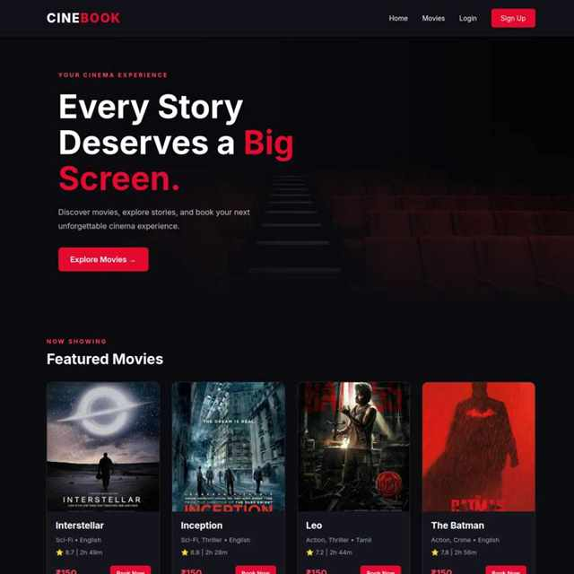
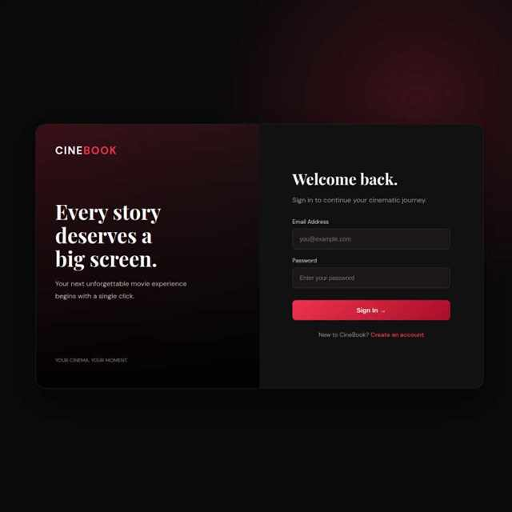
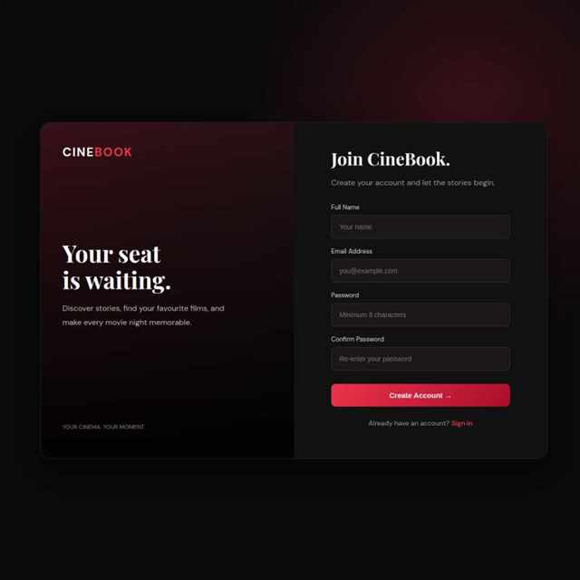

# CineBook — Movie Ticket Booking System

CineBook is a Java web application for browsing movies, creating an account, booking tickets, and viewing booking history. It uses JSP and Jakarta Servlets on Apache Tomcat, with MongoDB for user and booking data.

## Live application

**Open CineBook:** [https://cine-book-movie-ticket-booking-syst.vercel.app/](https://cine-book-movie-ticket-booking-syst.vercel.app/)

The Vercel deployment runs the application in a Tomcat container. Movie listings come from the project's `src/main/webapp/data/movies.json` file. Registration, login, and bookings need a reachable MongoDB database.

## Screenshots

Screenshots below show the public live application. The forms are empty; no account information is included.

### Home and movie listings



### Login



### Create an account



## Features

- Browse movie listings, posters, descriptions, ratings, show times, and ticket prices.
- Register and log in with BCrypt password hashing.
- Book 1–10 seats for a supported movie and future show date.
- See a booking confirmation and view your booking history.
- Protect booking and account pages with Java sessions and an authentication filter.
- Use a responsive interface on desktop and mobile devices.

## Technology

| Area | Technology |
| --- | --- |
| Frontend | HTML, CSS, JavaScript |
| Web application | Java, JSP, Jakarta Servlets |
| Servlet container | Apache Tomcat 11 |
| Database | MongoDB |
| Password hashing | jBCrypt |
| Production hosting | Vercel container deployment |

MongoDB and BCrypt driver JARs are included in `src/main/webapp/WEB-INF/lib`. This Eclipse project does not use Maven or Gradle.

## Project layout

```text
CineBook/
├── src/main/java/com/cinebook/     # Servlets, authentication filter, MongoDB connection
├── src/main/webapp/
│   ├── css/                         # Page styles
│   ├── data/movies.json             # Movie catalogue
│   ├── images/                      # Movie posters
│   ├── js/                          # Frontend movie loading
│   ├── WEB-INF/lib/                 # MongoDB and BCrypt libraries
│   ├── WEB-INF/web.xml              # Web application configuration
│   └── *.jsp                        # Home, login, registration, booking pages
├── Dockerfile                       # Local/general Tomcat container
├── Dockerfile.vercel                # Vercel deployment container
└── README.md
```

## Run locally in Eclipse

### Requirements

- Java JDK 17 or newer
- Eclipse IDE for Enterprise Java and Web Developers
- Apache Tomcat 11
- A local MongoDB server or a MongoDB Atlas cluster

### Steps

1. Clone the repository:

   ```bash
   git clone https://github.com/atharsharagavan/CineBook-Movie-Ticket-Booking-System.git
   ```

2. In Eclipse, choose **File → Import → General → Existing Projects into Workspace**, select the cloned `CineBook` folder, and finish the import.
3. Configure Tomcat 11 in Eclipse and add the CineBook project to the server.
4. Configure the database connection as described below.
5. Start Tomcat and open:

   ```text
   http://localhost:8080/CineBook/
   ```

If Eclipse deploys the application with a different context path, use that path in the URL.

## Configure MongoDB

The application reads the connection string from the `MONGODB_URI` environment variable. If it is unset, the local default is:

```text
mongodb://localhost:27017
```

The application uses the database named `cinebook`. It creates/uses the `user` collection for accounts and the `bookings` collection for bookings.

### Local MongoDB

Start MongoDB locally and leave `MONGODB_URI` unset, or set it to your local connection string. In Eclipse, environment variables can be added to the Tomcat server launch configuration.

### MongoDB Atlas

1. Make sure the Atlas cluster is active (resume it if it has paused).
2. Create a database user with only the permissions the app needs.
3. Add the application host to the Atlas project's **Network Access → IP Access List**.
4. Copy the cluster's driver connection string and substitute your database user's credentials. URL-encode special characters in the username or password.
5. Set the completed string as `MONGODB_URI` in the app's environment.


## Vercel deployment

The linked Vercel project deploys the GitHub `main` branch using `Dockerfile.vercel`.

For a new Vercel project:

1. Import this GitHub repository into Vercel.
2. Configure the project to build with `Dockerfile.vercel`.
3. Add `MONGODB_URI` in **Project Settings → Environment Variables**. Store it as a secret and enable it for Production (and Preview if needed).
4. Ensure the Atlas cluster is active and Atlas Network Access permits connections from the Vercel deployment.
5. Deploy. When you change environment variables, redeploy so the new deployment receives them.

The live site is public. Never put `MONGODB_URI` in frontend code or expose it to the browser. If the Atlas IP access list contains `0.0.0.0/0`, it allows connection attempts from any IPv4 address; remove that rule when you can use a narrower access method.

## Troubleshooting

- **Home page works, but registration/login/booking fails:** verify `MONGODB_URI` is set in Vercel Production, redeploy after changing it, confirm the Atlas cluster is running, and check Atlas Network Access.
- **Atlas times out or refuses connections:** confirm the cluster is active and its IP access list permits the deployment's outbound connection.
- **Local app cannot connect:** confirm MongoDB is running locally or set `MONGODB_URI` in Eclipse's Tomcat launch configuration.
- **Changes do not appear on Vercel:** check the latest deployment in the Vercel project and confirm the commit was pushed to `main`.

## Current limitations

- Movie data is a static JSON catalogue; movie administration, search, and filtering are not implemented.
- Seat inventory is not tracked, so the app does not prevent multiple users from selecting the same seats.
- Payment processing and email confirmations are not implemented.
- The ticket price and supported show times are currently defined by the application.

## Developer

**Atharsha Ragavan**  
GitHub: [@atharsharagavan](https://github.com/atharsharagavan)


